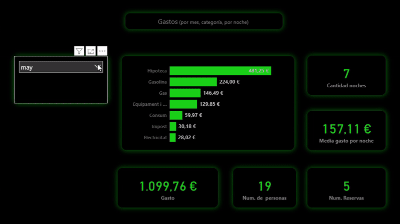
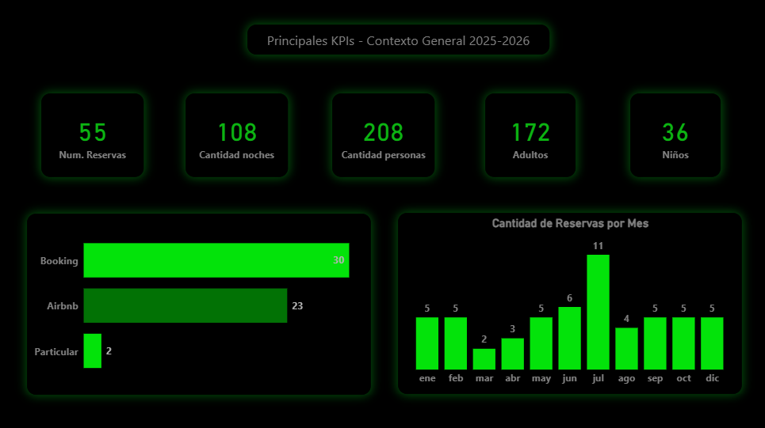
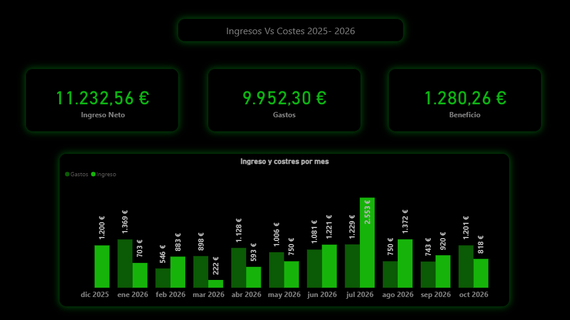
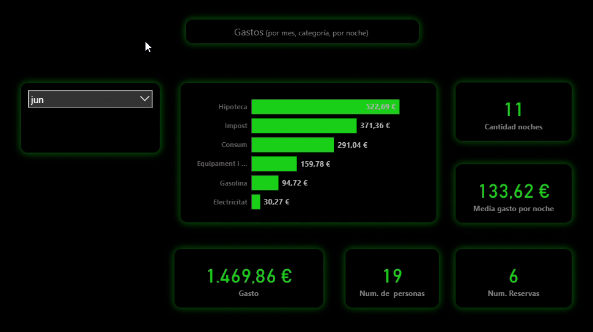

# 🏠 Análisis de rendimiento de un apartamento turístico — Power BI

Proyecto personal de análisis de datos en el que estudio el rendimiento de un apartamento de alquiler turístico a partir de sus reservas y sus gastos. El objetivo es reunir datos dispersos (exportaciones de Airbnb, Booking y registros propios en Excel) en un dashboard claro que responda a preguntas sencillas: **¿cuánto se ingresa, cuánto se gasta, cuándo se llena el apartamento y por qué canal llegan las reservas?**

> ⚠️ **Sobre los datos:** este repositorio utiliza un **dataset ficticio** creado para el portfolio. Mantiene la estructura y la lógica de unos datos reales, pero todas las cifras son inventadas. La versión con datos reales se conserva de forma privada.



---

## 🎯 Objetivos

- Centralizar en un único modelo los datos de varias plataformas de reserva y los gastos del piso.
- Calcular los KPIs básicos del negocio: reservas, noches, huéspedes, ingresos, gastos y beneficio.
- Detectar la estacionalidad y los meses en los que el apartamento no cubre sus costes.
- Practicar el flujo completo de un proyecto: limpieza, modelado, medidas DAX y diseño de informes.

---

## 🗂️ Fuentes de datos

| Fuente | Formato | Contenido |
|---|---|---|
| Airbnb | CSV | Reservas, fechas, huéspedes, importes |
| Booking | Excel / CSV | Reservas, fechas, huéspedes, importes |
| Registro propio | Excel | Reservas particulares y gastos por categoría |

*(Todas ficticias en esta versión pública.)*

---

## 📊 Dashboard

El informe tiene **tres páginas**:

### 1. Principales KPIs — contexto general

Visión global de la actividad: número de reservas, noches, huéspedes (adultos y niños), reparto por canal y reservas por mes.



### 2. Ingresos vs. costes

Ingreso neto, gastos y beneficio del periodo, con la comparación mensual entre lo que entra y lo que sale.



### 3. Gastos (por mes, categoría y noche)

Página interactiva con un selector de mes que muestra el desglose de gastos por categoría (hipoteca, impuestos, consumos, equipamiento, suministros…), el gasto total y el **gasto medio por noche** ocupada.



---

## 📐 KPIs y medidas

| KPI | Descripción |
|---|---|
| **Núm. reservas** | Total de reservas del periodo |
| **Cantidad de noches** | Noches ocupadas |
| **Cantidad de personas** | Huéspedes totales, separados en adultos y niños |
| **Ingreso neto** | Ingresos tras comisiones de plataforma |
| **Gastos** | Suma de gastos del apartamento |
| **Beneficio** | Ingreso neto − gastos |
| **Gasto medio por noche** | Gastos del mes / noches ocupadas |
| **Reservas por canal** | Booking, Airbnb o particular |

---

## 🔍 Principales hallazgos *(datos ficticios)*

- **55 reservas** y **108 noches** en el periodo, con una estancia media de unas **2 noches** y unos **4 huéspedes por reserva**.
- **Booking es el canal principal** (30 reservas), seguido de Airbnb (23). Las reservas particulares son residuales (2).
- **Julio es el pico de la temporada**: 11 reservas y más de 2.500 € de ingresos, el doble que cualquier otro mes.
- El apartamento cierra el periodo con un **beneficio de 1.280 €**, un margen de alrededor del **11 %** sobre el ingreso neto.
- Sin embargo, **en 5 de los 11 meses los gastos superan a los ingresos** (enero, marzo, abril, mayo y octubre). La rentabilidad depende mucho del verano.
- La **hipoteca** es, con diferencia, el gasto más alto todos los meses, así que el gasto por noche se dispara en los meses con poca ocupación.

---

## 🛠️ Herramientas

- **Power BI Desktop**: modelado, medidas DAX y visualización
- **Power Query**: limpieza y unificación de las fuentes
- **Excel**: registro y preparación de datos
- **GitHub**: documentación y publicación del proyecto

---

## 🔄 Proceso

1. **Extracción** de los datos de cada plataforma y del registro propio.
2. **Limpieza y transformación** en Power Query: unificación de columnas, formatos de fecha y categorías de gasto.
3. **Modelado** con tablas de reservas y gastos relacionadas mediante una tabla calendario.
4. **Medidas DAX** para los KPIs (beneficio, gasto por noche, etc.).
5. **Diseño del informe** en tres páginas, con un estilo oscuro coherente y filtros por mes.

---

## 📁 Estructura del repositorio

```
├── data/              # Dataset ficticio (CSV / Excel)
├── images/            # Capturas y GIF del dashboard
├── dashboard.pbix     # Archivo de Power BI
└── README.md
```

---

## 🚀 Próximas mejoras

- [ ] Añadir tasa de ocupación, ADR (precio medio por noche) y RevPAR
- [ ] Comparar el rendimiento de cada canal descontando sus comisiones
- [ ] Incluir la antelación media de las reservas
- [ ] Publicar el informe en Power BI Service

---

## 👤 Autor

**Albert Armentano**
Analista de datos en formación — IT Academy (Barcelona Activa)

[LinkedIn](#) · [GitHub](#)
